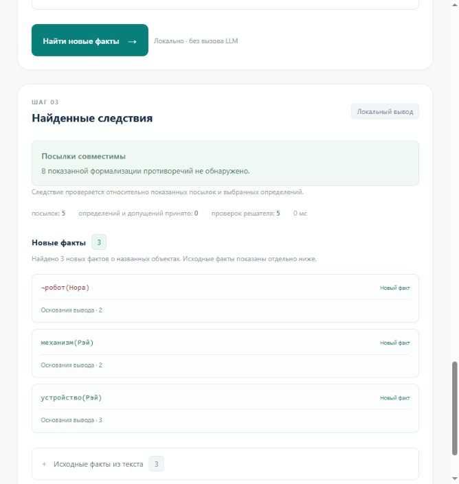

# Лаборатория фактов

Учебный проект по математической логике и теории алгоритмов: извлечение знаний из русского текста и поиск новых фактов. Сайт работает на FastAPI. Внешняя LLM переводит текст в JSON, а Python проверяет формализацию и выполняет логический анализ локально.

Пользователю достаточно написать исходные утверждения. Заранее задавать вопросы для поиска следствий не нужно.



## Быстрый запуск

Нужен Python 3.11 или новее. Из корня репозитория:

```powershell
python -m venv .venv
.\.venv\Scripts\python.exe -m pip install -e .
.\.venv\Scripts\python.exe -m factlab
```

На Linux/macOS:

```bash
python3 -m venv .venv
.venv/bin/python -m pip install -e .
.venv/bin/python -m factlab
```

Откройте <http://127.0.0.1:8000>. Готовые примеры и локальный вывод работают без API-ключа. Остановка сервера: `Ctrl+C`.

После активации окружения можно использовать команду `factlab`. Другой порт: `factlab --port 8001`. Для разработки: `factlab --reload`. Полная документация HTTP API: <http://127.0.0.1:8000/docs>.

## Подключение LLM

Скопируйте `.env.example` в `.env` в корне проекта и заполните:

```dotenv
LLM_API_KEY=ваш_ключ
LLM_BASE_URL=https://api.openai.com/v1
LLM_MODEL=название_модели_у_провайдера
```

Поддерживается OpenAI-совместимый Chat Completions API. Для другого провайдера замените базовый URL на адрес его API с окончанием `/v1`. Перезапустите сервер после изменения настроек.

Файл `.env` читается из текущей рабочей папки. Альтернативный путь задаётся переменной `FACTLAB_ENV_FILE`. Переменные среды имеют приоритет над `.env`. Дополнительные параметры и пояснения находятся в [.env.example](.env.example). Настоящие ключи в репозитории отсутствуют.

Формализация вызывает модель один раз. Повторные платные запросы и автоматический «ремонт» ответа отключены. Нажатие «Найти новые факты» запускает только локальный анализ.

## Пример

```text
Каждый робот — механизм.
Каждый механизм — устройство.
Рэй — робот.
Нора — устройство.
Нора не является механизмом.
```

После формализации общий режим находит `mechanism(ray)`, `device(ray)` и `¬robot(nora)`. Для каждого результата показываются основания. Если знаний недостаточно, приложение не считает отсутствие факта его отрицанием.

## Два режима

| Режим | Метод | Назначение |
|---|---|---|
| Общий, `/` и `/general` | Проверки следования через Z3 | Динамический словарь, кванторы, отрицание, дизъюнкции и равенство |
| Профили, `/profiles` | Собственный полунаивный Datalog и BFS | Безопасные правила, конечное замыкание и объяснения по шагам |

Определения и допущения, которые предлагает LLM сверх явно написанного текста, изначально выключены. Пользователь выбирает их отдельно.

Общий режим ограничен 8 секундами и 120 именованными атомами-кандидатами на анализ. Он не перечисляет все формулы первого порядка. При противоречивых посылках приложение блокирует выдачу следствий. Подробнее: [архитектура](docs/architecture.md), [алгоритмы](docs/algorithms.md), [ограничения и известные проблемы](docs/limitations.md).

## Структура

```text
src/factlab/
  web/          FastAPI, LLM-клиент, Z3 и статический интерфейс
  datalog/      модели фактов, правила, полунаивный вывод и BFS
  prompts/      промпты формализации и извлечения фактов
  data/         профили и готовые примеры
  legacy/       первый учебный прототип для сравнения
tests/          офлайн-тесты и отдельные фикстуры
docs/           описание, презентация и историческое ревью Astra
.github/        CI для Linux и Windows
```

Пути не зависят от исходной учебной папки и имени пользователя. JSON, промпты и интерфейс включаются в устанавливаемый Python-пакет. Исходные учебные материалы, окружения, служебные кэши и сырые платные прогоны в репозиторий не включены.

## Проверки

Из активированного окружения в корне репозитория:

```bash
python -m unittest discover -s tests -t . -p "test_*.py" -v
python -m pip wheel . --no-deps --wheel-dir dist
```

Тесты используют подготовленные данные и подставной HTTP-клиент. Они не вызывают платную LLM. GitHub Actions запускает их на Linux с Python 3.11/3.12 и Windows с Python 3.11.

Полунаивный вывод можно запустить отдельно:

```bash
python -m factlab.datalog.run_inference --bfs requires --strict-order requires --out inference-result.json
```

По умолчанию CLI использует встроенный базовый пример. После установки доступна и команда `factlab-infer` с теми же аргументами.

## Материалы семинара

- [Презентация: 16 слайдов, 15–20 минут](docs/presentation.pptx)
- [Ревью Astra исходной семинарской версии](docs/review-astra.md)
- [LLM-промпт общего режима](src/factlab/prompts/formalization.txt)
- [LLM-промпт Datalog-профилей](src/factlab/prompts/extraction.txt)

Лицензия на распространение кода пока не выбрана. Иллюстрация Wikidata в презентации имеет отдельную атрибуцию и лицензию CC BY-SA 4.0 в заметках первого слайда.
